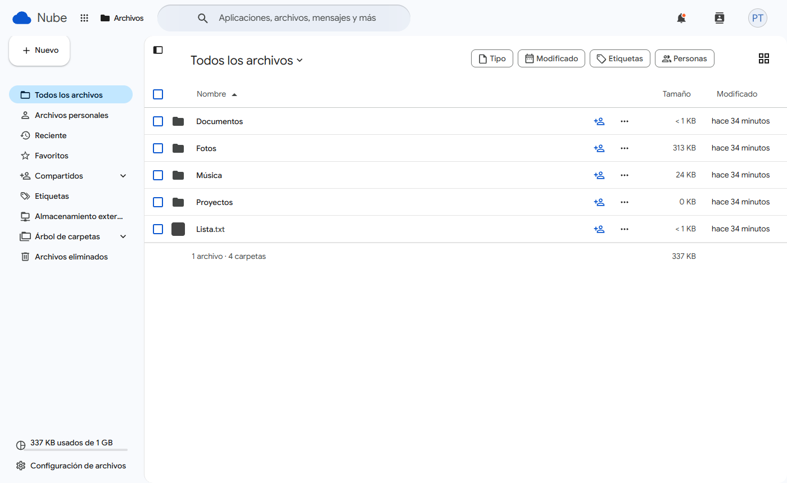
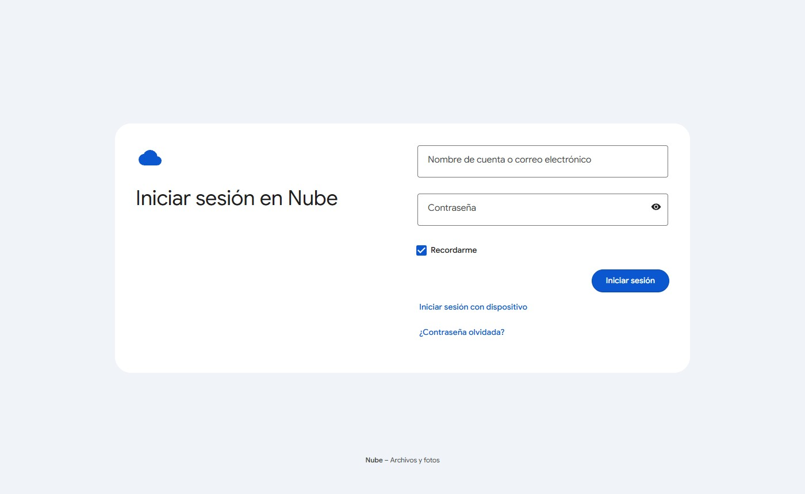
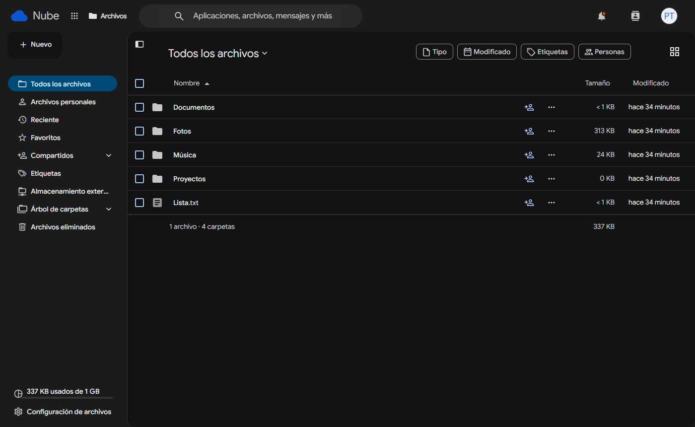
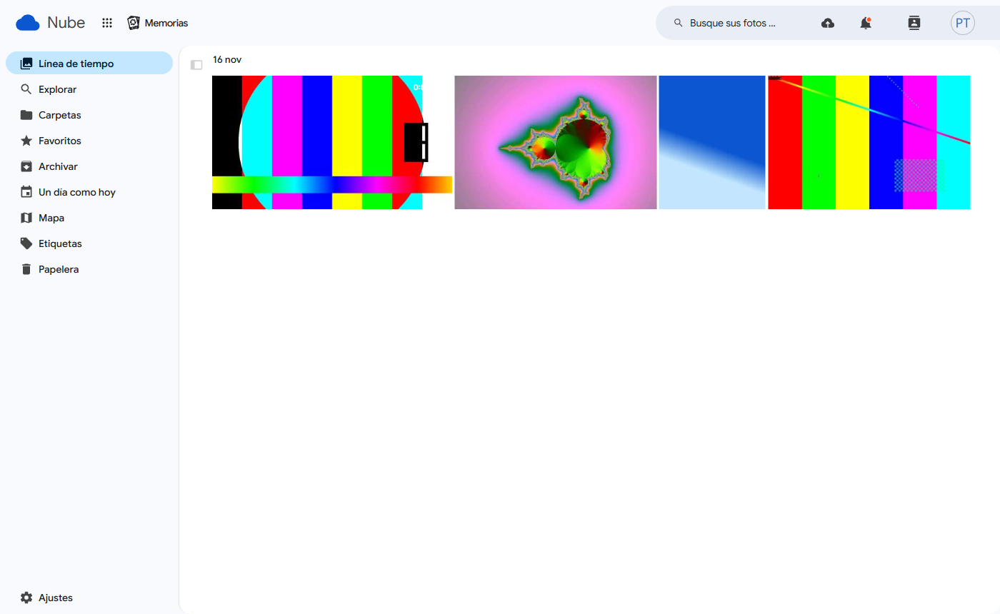
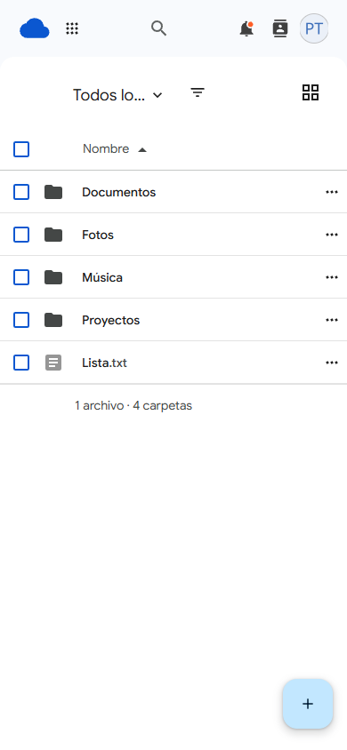

# Nube: a Google Drive style theme for Nextcloud

Nube makes Nextcloud look like Google Drive and the rest of Google Workspace. It copies the sign-in card, the
header with a large rounded search field, the pill-shaped navigation, the gray folders, and the Material 3
buttons, menus, and dialogs. Light and dark mode are both included.

Nube is a theme only. Nextcloud works the same way, and every app keeps its features.

> Nube is not affiliated with or endorsed by Google. "Google Drive" and "Google Workspace" only describe the
> look that the theme copies. The theme ships no Google logos or icons.



## Screenshots

| Sign-in | Files in dark mode |
| --- | --- |
|  |  |

| Photos (Memories app) | Phone |
| --- | --- |
|  |  |

The screenshots come from Nextcloud 35.0.3 with the Spanish interface and test files.

## What changes

Each part follows the Google screen it copies:

- **Sign-in:** a two-column card. The large title is on the left, and the outlined fields and a pill sign-in
  button are on the right. On phones the card goes away and the form fills the screen.
- **Header:** the logo and the instance name on the left, a 48 px rounded search field, and round icon buttons.
- **Navigation:** the active entry is a light blue pill. The **New** button sits at the top of the column on
  desktop. On phones it becomes a floating button at the bottom right.
- **Files:** the content sits on a white card with 16 px corners. The list uses 48 px rows and gray folders.
  The filters are outlined chips, and the checkboxes appear only on hover.
- **Controls:** the theme restyles buttons, text fields, menus with 8 px corners, dialogs with 28 px corners,
  notification snackbars, and tooltips.
- **Other apps:** the shared styles also cover Settings, Memories, and the public share pages.
- **Font:** Google Sans, served from your own server. The browser makes no requests to Google.
- **Dark mode:** it follows the Nextcloud appearance setting. With the default setting, it follows the system.

## Why updates do not break it

Themes that replace Nextcloud templates break on almost every update. Nube replaces nothing:

- It is a small app that adds two CSS files. It does not touch templates, JavaScript, or core files.
- Most of the look comes from the Nextcloud design variables (`--color-*`, `--border-radius-*`, `--font-face`).
  Nextcloud keeps these variables stable for app developers.
- Selectors use only the stable component classes from `@nextcloud/vue`, such as `.button-vue` and
  `.app-navigation-entry`. They never use the hashed classes that change on every build.
- `appinfo/info.xml` allows only the Nextcloud version that the theme was tested on. When you upgrade to a new
  major version, Nextcloud disables the app and the default look comes back. To use the theme again, test it,
  raise `max-version`, and enable the app.

## Install

Nube needs Nextcloud 35.

1. Clone the theme into the `apps` folder of your Nextcloud. The folder must be named `nube_theme`:

	```sh
	cd /path/to/nextcloud/apps
	git clone https://github.com/Krlooo/nextcloud-nube-theme.git nube_theme
	```

2. Enable the app from the Nextcloud folder:

	```sh
	php occ app:enable nube_theme
	```

3. Optional: set the matching logo and colors in **Administration settings > Theming**, or with `occ`:

	```sh
	php occ theming:config logo apps/nube_theme/img/logo.svg
	php occ theming:config primary_color "#0b57d0"
	php occ theming:config background_color "#f8fafd"
	```

4. Optional: set the instance name in **Administration settings > Theming**. The header shows the name next to
   the logo. In the screenshots the name is "Nube".

To update the theme, run `git pull` in `apps/nube_theme`. Then run `php occ maintenance:theme:update` so that
browsers load the new CSS.

## Remove

To go back to the default look, disable the app:

```sh
php occ app:disable nube_theme
```

## Change the colors

The colors are tokens at the top of `css/nube.css`, such as `--nube-primary`, `--nube-selected`, and `--nube-bg`.
Light mode and dark mode each have one block of tokens. When you change a token, every rule that uses it follows.

`css/nube.css` has numbered sections: tokens, Nextcloud variables, base, header, layout, navigation, files,
controls, popovers and dialogs, settings and other apps, and sign-in pages.

## Known limits

- CSS restyles Nextcloud, but it cannot move features between menus. The app menu, the account menu, and the
  file actions stay where Nextcloud puts them.
- The theme was checked on the sign-in page, Files, the file details sidebar, Settings, Memories, and phone
  widths. Other apps get the shared styles but may need extra rules.
- The two-factor sign-in screens use the same card, but nobody has checked them with screenshots yet.

## License

- The theme code is under the [GNU AGPL v3](LICENSE), like Nextcloud.
- Google Sans is under the [SIL Open Font License 1.1](css/fonts/OFL.txt). Google released the font as open
  source in 2025.
